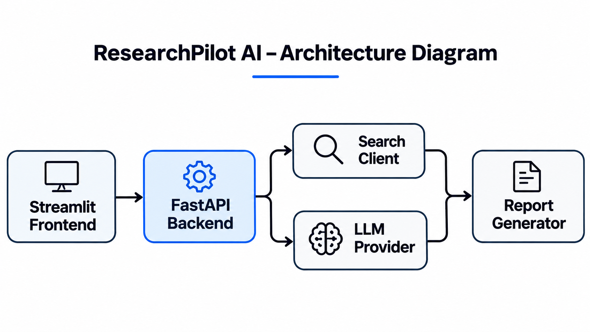
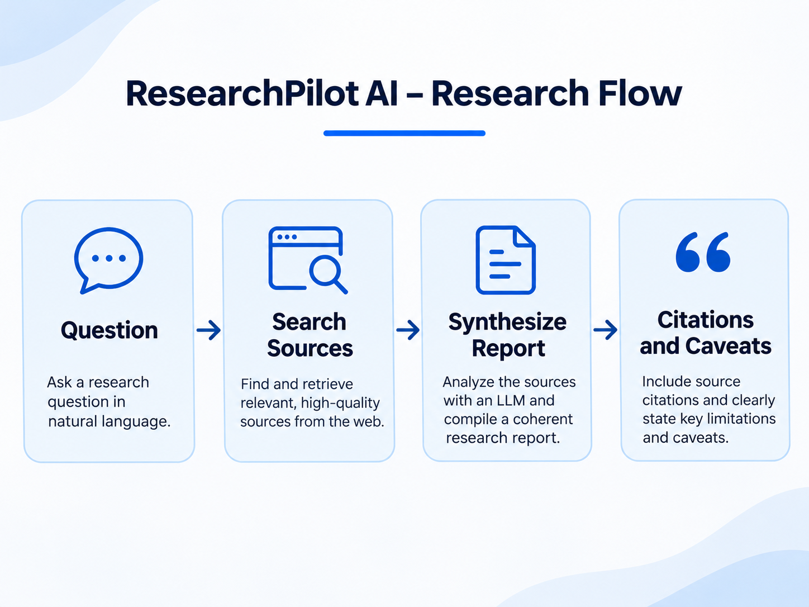
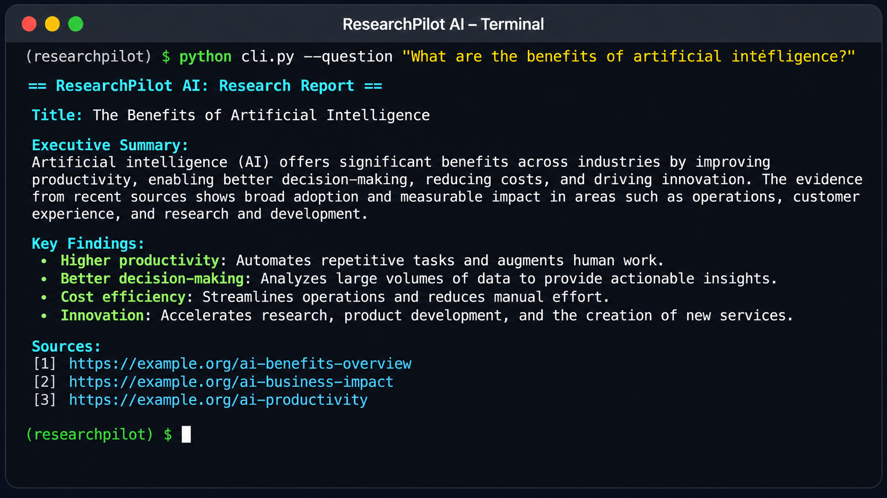

# ResearchPilot AI

Evidence-oriented web research assistant. FastAPI backend + Streamlit frontend.

## Setup

```bash
python -m venv .venv
source .venv/bin/activate
pip install -r requirements.txt
cp .env.example .env
```

## Run

Start the backend:

```bash
uvicorn backend.main:app --reload
```

Start the frontend:

```bash
streamlit run app.py
```

## CLI

```bash
python cli.py --question "your question"
```

## Tests

```bash
pytest
```

## Assets

Project images are stored in `assets/images/`.







